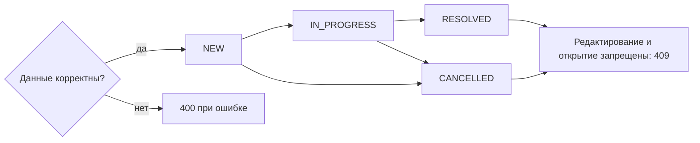
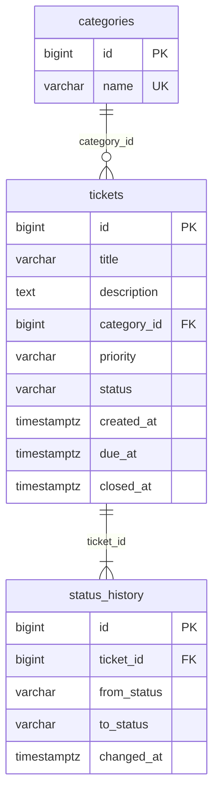

# Сервис обработки заявок

REST API технической поддержки на Java и Kotlin: регистрация обращений, управление статусами и сроками, история, поиск и статистика. Пользователи: сотрудник, оператор, руководитель и администратор стенда. Один сервис Spring Boot и PostgreSQL; пользовательский интерфейс, аутентификация, уведомления и вложения в объём проекта не входят. API проверяется через Swagger UI или Postman.

## 1. Технологии и запуск

| Компоненты | Версии |
| --- | --- |
| Java / Spring Boot / Kotlin | JVM 21, Temurin 21.0.9+10 в контейнере / 3.5.7 / 2.1.21 |
| Gradle Wrapper / PostgreSQL | 8.14.3, checksum закреплён / 17.6-alpine |
| Testcontainers / OpenAPI / JaCoCo | 1.21.3 / springdoc 2.8.14 / 0.8.13 |
| Форматирование | Spotless 7.0.4, google-java-format 1.24.0, ktfmt 0.54 |
| Flyway, JDBC driver, JUnit, Mockito | Версии из BOM Spring Boot 3.5.7 |
| Docker Compose | v2, проверено с 2.40.3; Docker Engine 25+ |

Сборка использует Maven Central и Gradle Plugin Portal; динамических версий и SNAPSHOT нет. Java и Kotlin компилируются в одном Gradle-проекте для JVM 21. Для ВМ рекомендуется 4 vCPU, 6 ГБ RAM, 25 ГБ диска и доступ в интернет при первой сборке.

Установка инструментов на Kali Linux:

```bash
sudo apt update
sudo apt install -y git docker.io docker-compose openjdk-21-jdk curl python3 openssl
sudo systemctl enable --now docker
sudo usermod -aG docker "$USER"
```

Повторно войти в сеанс и проверить `docker info` и `docker compose version`. Если Compose v2 установлен только как `docker-compose`, подключить его как плагин:

```bash
sudo install -d /usr/local/lib/docker/cli-plugins
sudo ln -sf /usr/bin/docker-compose /usr/local/lib/docker/cli-plugins/docker-compose
```

```bash
git clone https://github.com/Zuika1166/practika_ychhhh.git
cd practika_ychhhh
bash scripts/init-env.sh
docker compose up -d --build --wait --wait-timeout 180
curl --fail http://127.0.0.1:8080/actuator/health/readiness
python3 scripts/smoke.py
```

Swagger: http://127.0.0.1:8080/swagger-ui/index.html. OpenAPI: http://127.0.0.1:8080/v3/api-docs. Версия: http://127.0.0.1:8080/actuator/info. Ожидается readiness UP, smoke PASS, оба контейнера healthy.

`init-env.sh` создаёт .env со случайным паролем и сохраняет существующую конфигурацию. .env.example содержит только параметры без секретов. Переменные: DB_NAME, DB_USER, DB_PASSWORD, APP_IMAGE, APP_BIND, APP_PORT; приложение принимает DB_URL и SERVER_PORT. По умолчанию порт доступен на loopback. В VirtualBox этот адрес относится к Kali; доступ с хоста требует проброса порта и настройки APP_BIND. Скрипты проверок используют BASE_URL, по умолчанию http://127.0.0.1:8080.

Остановка: `docker compose down`; повторный запуск: `docker compose up -d --no-build --wait --wait-timeout 180`. Том PostgreSQL сохраняется; `down -v` удаляет его. Для обновления исходников и локального образа: `git pull --ff-only`, затем `docker compose up -d --build --wait`. Демонстрационные данные создаёт `python3 scripts/seed-demo.py`; повторный запуск добавляет записи.

## 2. Требования и критерии приёмки

| История / требование | Потребность и проверяемый результат |
| --- | --- |
| US-01 / F-01 | Сотрудник создаёт заявку: 201, Location, id, NEW, createdAt и начальная история. Неверные поля или категория — 400 без вставки. |
| US-02 / F-02 | Оператор получает карточку и категории; отсутствующая заявка — 404 с единым JSON ошибки. |
| US-03 / F-03 | Оператор меняет description, priority, dueAt открытой заявки; null снимает срок. Для RESOLVED/CANCELLED — 409, данные сохраняются. |
| US-04 / F-04 | Оператор меняет статус по схеме ниже. Терминальный статус заполняет closedAt; повтор того же статуса и открытие закрытой заявки дают 409. |
| US-05 / F-05 | История упорядочена по id; смена статуса и запись истории атомарны. Ошибка истории откатывает статус и closedAt. |
| US-06 / F-06 | Поиск комбинирует status, priority, categoryId, overdue, from, to через AND. page от 0, size 1–100; сортировка createdAt DESC, id DESC. |
| US-07 / F-08 | Руководитель получает сводку по одной выборке [from,to). Среднее только для RESOLVED; без завершённых — null. Неверный период — 400. |
| US-08 / N-02 | После пересоздания контейнеров данные сохраняются; backup восстанавливается в отдельную БД, все три таблицы совпадают с исходными. |
| US-09 | Администратор получает проверенный образ через CI/CD; PR проходит проверки, main доставляется на стенд; доступен возврат прежнего образа. |

Дополнительные правила: title обязателен, максимум 200 символов; categoryId должен существовать; priority — LOW, MEDIUM или HIGH и обязателен. description по умолчанию пустая строка, максимум 10000 символов; dueAt необязателен. PUT заменяет description, priority и dueAt, сохраняя заголовок и категорию. F-07: просрочка означает открытый статус и dueAt < now; ровно в dueAt просрочки ещё нет. F-09: валидация — 400, неизвестная заявка — 404, запрещённая операция — 409.

Нефункциональные требования: N-01 — воспроизводимый запуск и закреплённые версии; N-02 — постоянный том; N-03 — окружение и Secrets, .env исключён из Git; N-04 — stdout-логи, readiness с проверкой БД и непривилегированный пользователь контейнера; N-05 — UTC/Instant и управляемый Clock; N-06 — PostgreSQL Testcontainers, JUnit/JaCoCo и форматирование; N-07 — loopback по умолчанию; N-08 — ограничения памяти app 768 MiB и db 512 MiB. Численный SLA нагрузки не задан; нагрузочное тестирование не входит в объём.

## 3. Процесс и данные





Схема и справочник создаются [миграциями Flyway](src/main/resources/db/migration). Начальная история: fromStatus=null, toStatus=NEW. Внешние ключи и CHECK-ограничения обеспечивают целостность. Индексы поддерживают поиск по времени, статусу/сроку, категории/приоритету и истории. JdbcTemplate выполняет параметризованные SQL-запросы; SELECT FOR UPDATE сериализует изменения заявки, @Transactional объединяет смену статуса и историю.

## 4. REST API

JSON, время ISO-8601 с часовым поясом. Полный контракт: [OpenAPI JSON](api/openapi.json); проверочные запросы: [коллекция Postman](api/helpdesk.postman_collection.json). В Postman запросы выполняются по порядку, ticketId сохраняется автоматически. Примеры времени ниже иллюстративны.

| Метод и путь | Запрос | Успешный ответ |
| --- | --- | --- |
| POST /api/tickets | title, description, categoryId, priority, dueAt | 201 + Location, Ticket |
| GET /api/tickets/{id} | id | 200, Ticket |
| PUT /api/tickets/{id} | description, priority, dueAt | 200, Ticket |
| PATCH /api/tickets/{id}/status | status | 200, Ticket |
| GET /api/tickets | Фильтры, page, size | 200, TicketPage |
| GET /api/tickets/{id}/history | id | 200, массив истории |
| GET /api/categories | — | 200, массив категорий |
| GET /api/reports/summary | from, to обязательны; from < to | 200, SummaryReport |
| GET /actuator/health/readiness | — | 200 UP или 503 |
| GET /actuator/info | — | 200, версия образа |

POST /api/tickets:

```json
{"title":"Не работает принтер","description":"Кабинет 104","categoryId":1,"priority":"HIGH","dueAt":"2030-01-20T16:00:00Z"}
```

Ticket в ответах POST/GET/PUT/PATCH:

```json
{"id":1,"title":"Не работает принтер","description":"Кабинет 104","categoryId":1,"priority":"HIGH","status":"NEW","createdAt":"2030-01-15T10:00:00Z","dueAt":"2030-01-20T16:00:00Z","closedAt":null}
```

Примеры PUT и PATCH соответственно:

```json
{"description":"Заменить кабель","priority":"MEDIUM","dueAt":null}
```

```json
{"status":"IN_PROGRESS"}
```

GET /api/tickets?status=NEW&priority=HIGH&categoryId=1&overdue=true&page=0&size=20:

```json
{"content":[],"page":0,"size":20,"totalElements":0,"totalPages":0}
```

Элементы content имеют структуру Ticket. from включается, to исключается. overdue=false включает заявки без срока и терминальные заявки; за последней страницей content пустой.

Примеры ответов категорий и истории:

```json
[{"id":1,"name":"Оборудование"},{"id":2,"name":"Программное обеспечение"},{"id":3,"name":"Сеть"}]
```

```json
[{"id":1,"ticketId":1,"fromStatus":null,"toStatus":"NEW","changedAt":"2030-01-15T10:00:00Z"}]
```

GET /api/reports/summary?from=2030-01-01T00:00:00Z&to=2030-02-01T00:00:00Z:

```json
{"from":"2030-01-01T00:00:00Z","to":"2030-02-01T00:00:00Z","createdCount":3,"byStatus":{"NEW":1,"IN_PROGRESS":0,"RESOLVED":1,"CANCELLED":1},"byPriority":{"LOW":1,"MEDIUM":1,"HIGH":1},"overdueOpenCount":1,"averageResolutionSeconds":180.0}
```

Все показатели используют заявки, созданные в [from,to). Статусы берутся текущие; просрочка определяется на момент запроса. Среднее — closedAt-createdAt только для RESOLVED, в секундах с дробной частью. Пустая выборка возвращает нули и среднее null. Все статусы и приоритеты присутствуют, включая нулевые значения.

Единый формат ошибки:

```json
{"timestamp":"2030-01-15T11:00:00Z","status":409,"code":"INVALID_TRANSITION","message":"Переход статуса запрещён","path":"/api/tickets/1/status","violations":{}}
```

Bean Validation возвращает VALIDATION_ERROR с violations; неверный JSON, enum или параметр — INVALID_REQUEST; отсутствующая заявка — TICKET_NOT_FOUND. Неположительный id и неизвестные поля JSON отвергаются с 400.

## 5. Java, Kotlin и тестирование

Java-контроллер ReportController вызывает Kotlin ReportService, который читает данные через Java-интерфейс ReportSource и JdbcTemplate-репозиторий TicketRepository. Все компоненты работают в одном JVM-приложении.

Два решения Kotlin: (1) data class SummaryReport и nullable Double? представляют модель и отсутствие среднего; ?.let, mapNotNull и takeIf безопасно обрабатывают отсутствующие значения и пустой набор; (2) groupingBy().eachCount(), associateWith, filter и average рассчитывают метрики из одной выборки, дополняя отсутствующие значения нулями. Kotlin-тест kotlinInvokesJavaServiceAndEnforcesTerminalStatus проверяет Java TicketService.

```bash
export JAVA_HOME=/usr/lib/jvm/java-21-openjdk-amd64
export PATH="$JAVA_HOME/bin:$PATH"
./gradlew --no-daemon spotlessCheck build
```

Требуются работающий Docker и JDK 21; Gradle установленный в системе не нужен. Testcontainers поднимает отдельную PostgreSQL 17.6; рабочая БД не используется. Время задаётся через Clock.fixed/MutableClock; перед интеграционными тестами очищаются заявки и история, сбрасываются идентификаторы и часы. Исправление форматирования: `./gradlew spotlessApply`.

Тест-план и связь с критериями приёмки:

| Требование | Проверка и ожидаемый результат |
| --- | --- |
| F-01,02 / US-01,02 | validatesRequiredTitleCategoryAndPriority, createsWithInitialHistoryAndReturnsSameRecord, returnsUniform404ForMissingTicketAndHistory: 201/400/404, верные поля и история |
| F-03,04 / US-03,04 | enforcesEveryTransition: все 16 пар; cancellationIsAllowedFromBothOpenStatuses; editsOpenTicketAndClearsDeadline: разрешённые операции сохраняются, запреты дают 409 |
| F-05 / US-05 | historyFailureRollsBackStatusAndClosingTime: ошибка истории откатывает запись; concurrentDuplicateTransitionWritesExactlyOneHistoryEntry: один успешный переход при двух запросах |
| F-06 / US-06 | filtersWithStablePaginationAndCorrectDeadlineBoundary: AND-фильтры, стабильные страницы, правильные totalElements и граница срока |
| F-07 | deadlineEqualityIsNotOverdueRegression, deadlineOneNanosecondEarlierIsOverdue, missingDeadlineIsNotOverdue: равный/будущий/null срок без просрочки |
| F-08 / US-07 | summaryUsesHalfOpenCreatedPeriodForEveryMetric, emptySelectionHasZeroCountsAndNullAverage, rejectsEqualAndReversedPeriods: одна выборка, нули/null, отказ неверному периоду |
| F-08 / D-01 | preservesSubMillisecondResolutionRegression: длительность 0,0005 секунды сохраняется |
| F-09 | validatesBodiesUnknownEnumsAndPagination: неверные поля, enum, категория и страница дают 400 |
| Сквозные сценарии | e2eFullLifecycleProducesReportAndOrderedHistory; e2eForbiddenOperationLeavesAllDataUnchanged: жизненный цикл и полное совпадение карточки/истории после запрета |
| US-08,09 | verify-storage.py, smoke.py, workflow и rollback.sh: сохранность, восстановление, успешная доставка и возврат версии |

Критерий прохождения: ноль ошибок и пропусков, readiness UP, smoke и проверка восстановления PASS. Результаты от 15 ноября 2026 года:

| Класс | Тестов | Падений / ошибок / пропусков |
| --- | --- | --- |
| StatusRulesTest | 22 | 0 / 0 / 0 |
| TicketServiceTest | 11 | 0 / 0 / 0 |
| ReportServiceTest, Kotlin | 8 | 0 / 0 / 0 |
| ApiIntegrationTest | 15 | 0 / 0 / 0 |
| Всего | 56 | 0 / 0 / 0 |

Из 15 интеграционных методов два — сквозные сценарии HTTP → PostgreSQL. JaCoCo: строки 219/224 (97,77%), ветви 83/86 (96,51%), инструкции 1290/1315 (98,10%). [Зафиксированные отчёты JUnit и JaCoCo](evidence/reports/index.html), [сводка](evidence/verification.json). После сборки: `build/reports/tests/test/index.html`, `build/reports/jacoco/test/html/index.html`, `build/test-results/test`.

Исправленные дефекты:

| ID | Воспроизведение и результат до исправления | Исправление и проверка |
| --- | --- | --- |
| D-01 | Передать RESOLVED с createdAt=2025-01-01T00:00:00Z и closedAt=2025-01-01T00:00:00.000500Z, получить summary: ожидалось 0.0005, возвращалось 0.0 | toMillis заменён на seconds + nano / 1e9. Регрессия preservesSubMillisecondResolutionRegression проходит; [протокол до исправления](evidence/defect-D01-before.txt) |
| D-02 | Запустить контейнер с HTTP-прокси: внешний readiness UP, внутренний wget получает 403, Compose не дожидается healthy | Локальный health check использует wget -Y off; readiness UP и smoke PASS |
| D-03 | Отправить первоначальный workflow в main: YAML с разорванной строкой printf завершается до jobs | Однострочный printf; YAML проверен, [PR №1](https://github.com/Zuika1166/practika_ychhhh/pull/1) и pipeline успешны |

## 6. Эксплуатация, CI/CD и откат

Dockerfile многоэтапный: сборка в JDK, runtime — JRE и JAR от непривилегированного пользователя. Compose задаёт постоянный том, health checks, ограничения памяти, окружение и зависимость app от готовности db. Миграции Flyway применяются автоматически; логи направляются в stdout/stderr.

Из рабочего каталога Compose:

```bash
bash scripts/backup.sh backups/manual.dump
bash scripts/restore.sh backups/manual.dump helpdesk_restore_check
python3 scripts/verify-storage.py
```

Backup — pg_dump custom-format. Restore создаёт отдельную новую базу и отказывается перезаписывать рабочую. verify-storage.py кратковременно пересоздаёт контейнеры, проверяет заявку и историю, восстанавливает копию и сравнивает categories, tickets и status_history целиком. Рабочие данные сохраняются.

[Workflow](.github/workflows/ci-cd.yaml): verify проверяет форматирование и тесты, публикует отчёты; publish собирает образ с тегом полного SHA и отправляет в GHCR; deploy запускает его на учебной ВМ, проверяет readiness и smoke и публикует протокол. PR получает только проверки, после слияния в main выполняется доставка. Связь через needs блокирует следующие этапы при ошибке проверки. Локальная последовательность без registry: `bash scripts/local-pipeline.sh`.

Стенд: /opt/helpdesk, runner с метками self-hosted/linux/x64/helpdesk-kali, GitHub environment training, variable STAND_DIR=/opt/helpdesk, secret DB_PASSWORD с действующим паролем базы. Каталог принадлежит пользователю runner с доступом к Docker. Runner регистрируется через GitHub Settings → Actions → Runners. GITHUB_TOKEN используется для GHCR. .env сохраняется между доставками; для нового тома пароль можно создать командой `openssl rand -hex 24`. При переносе работающей конфигурации требуется сохранить .env и пароль существующего тома.

```bash
cd /opt/helpdesk
bash scripts/deploy.sh ghcr.io/zuika1166/practika_ychhhh:60a2ce4259cedce23de43eae00e409c6b3b4e04b
bash scripts/rollback.sh ghcr.io/zuika1166/practika_ychhhh:9eb5ae4585c0965e3387c79b7f47836b89136ac2
curl --fail http://127.0.0.1:8080/actuator/info
python3 scripts/smoke.py
```

Без аргумента rollback использует .deploy/previous-image. deploy сохраняет текущий образ в .deploy/current-image и .env; flock защищает от одновременных запусков. Неуспешные readiness или smoke вызывают попытку возврата прежнего образа и ошибку доставки. Для скачивания отсутствующего локально приватного образа нужна авторизация в GHCR. Откат образа сохраняет БД; миграции должны быть совместимы с предыдущим кодом. В проверенных версиях схема одинаковая; practice-2 добавляет поле release в /actuator/info. Restore данных — отдельная операция.

Диагностика трёх сбоев:

| Ситуация | Проверка и действия |
| --- | --- |
| БД недоступна | docker compose ps; docker compose logs --tail=100 db app; pg_isready внутри db. Проверить DB_URL, пользователя, пароль и диск. Правка .env не меняет пароль существующего тома. |
| Приложение не проходит health check | Логи app, доступ к БД, память и порт; curl -i /actuator/health/readiness по базовому адресу. 503 — неготовность, connection refused — отсутствие доступного сервиса. |
| Ошибка миграции | Логи app и flyway_schema_history; проверить SQL, права и checksum. Применённый файл восстановить в исходном виде, исправление оформить новой миграцией после backup и проверки на отдельной базе. |

```bash
docker compose ps
docker compose logs --tail=100 app db
docker compose exec db sh -c 'pg_isready -U "$POSTGRES_USER" -d "$POSTGRES_DB"'
docker inspect --format '{{json .State.Health}}' "$(docker compose ps -q app)"
docker compose exec db sh -c 'psql -U "$POSTGRES_USER" -d "$POSTGRES_DB" -c "SELECT installed_rank, version, description, success FROM flyway_schema_history ORDER BY installed_rank;"'
```

## 7. Результаты развёртывания

На Kali Linux в VirtualBox 15 ноября 2026 года подтверждены 56 тестов на JDK 21.0.13, работа API, сохранность после пересоздания контейнеров, восстановление копии и возврат предыдущего образа. [Протокол стенда](evidence/kali-verification.json).

| Версия | SHA и успешный pipeline |
| --- | --- |
| Первая | `9eb5ae4585c0965e3387c79b7f47836b89136ac2` — [run](https://github.com/Zuika1166/practika_ychhhh/actions/runs/43745510914), [PR №1](https://github.com/Zuika1166/practika_ychhhh/pull/1) |
| practice-2 | `60a2ce4259cedce23de43eae00e409c6b3b4e04b` — [run](https://github.com/Zuika1166/practika_ychhhh/actions/runs/43756431655), [PR №2](https://github.com/Zuika1166/practika_ychhhh/pull/2) |

Образы: `ghcr.io/zuika1166/practika_ychhhh:<SHA>`. Digest manifest из логов публикации: первый — `sha256:27ce77f539f7766a7237b22a7a9e5042e15e8fe381da956a13b6dc0af16cece6`; второй — `sha256:108dc47bf75ec137a998f13fbb16b97258096ae48d15a5614fd67d4282b744dc`. Локальный RepoDigests доступен через docker image inspect.

Backup `backups/helpdesk-20261115T194643Z.dump` восстановлен в `restore_20261115194643`; совпали 4 заявки и 8 записей истории. После отката с practice-2 на первый образ сохранилась заявка №4, поле release исчезло, smoke создал заявки №8 и №9 с PASS, оба контейнера остались healthy. Дополнительная проверка [автоматического возврата при неуспешном health check](evidence/automatic-rollback.json) также завершилась PASS.

Первую доставку пришлось повторить после остановки runner при выгрузке отчёта; вторую публикацию — после HTTP 429 Maven Central. Итоговые verify, publish и deploy обоих запусков успешны.

## 8. Backlog и итоги практики

| ID | Работа | Связь | Приоритет | План, академ. ч |
| --- | --- | --- | --- | --- |
| B-01 | Анализ, истории и критерии | US-01–09 | P0 | 6 |
| B-02 | Схема, API, версии и Git | F-01–09 | P0 | 6 |
| B-03 | Создание, карточка, категории | US-01,02 | P0 | 6 |
| B-04 | Статусы, история, транзакции | US-04,05 | P0 | 7 |
| B-05 | Редактирование и поиск | US-03,06 | P0 | 5 |
| B-06 | Kotlin, статистика и взаимодействие | US-07 | P0 | 10 |
| B-07 | Тесты, исправления, покрытие | Все | P0 | 12 |
| B-08 | Docker, эксплуатация, backup/restore | US-08 | P0 | 8 |
| B-09 | CI/CD и откат | US-09 | P0 | 8 |
| B-10 | Документация и защита | Все | P1 | 4 |
| Итого | | | | 72 |

P0 — основной функционал и воспроизводимость; P1 — комплект сдачи. Порядок: анализ → проектирование → Java/Kotlin → тестирование → эксплуатация → CI/CD. Тесты и документация обновлялись вместе с реализацией. Фактические трудозатраты учитываются в журнале практики; таблица содержит плановые оценки.

Результат: реализован API Java, работающая статистика Kotlin, миграции, валидация, история и поиск; подготовлены тесты, отчёты, контейнеры, резервное копирование, две доставки и откат. Ограничения: отсутствуют аутентификация, назначения исполнителей, уведомления и вложения; отчёт отражает текущие состояния, нагрузочный SLA не задан. Исходники, тесты, миграции, коллекция API и машинные протоколы находятся в соответствующих каталогах репозитория.
