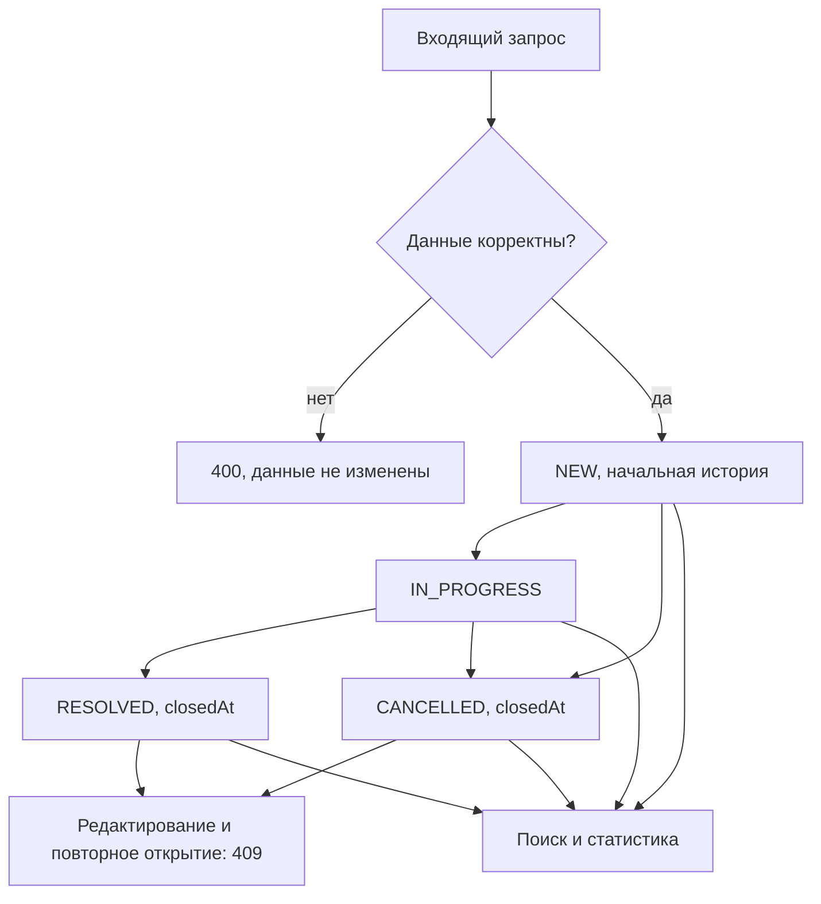
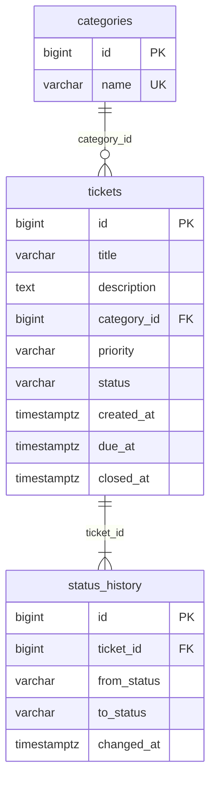

# Спецификация сервиса обработки заявок

## Проблема и границы

Разрозненные обращения теряются, сроки не отслеживаются, статистика рассчитывается вручную. Сервис хранит обращения, контролирует жизненный цикл и предоставляет REST API и сводку.

Пользователи: сотрудник регистрирует обращение; оператор просматривает, классифицирует и обрабатывает его; руководитель получает статистику; администратор обслуживает приложение. В учебной версии роли описывают сценарии, а не отдельные учётные записи.

В составе решения один сервер на Java и Kotlin и одна PostgreSQL. В обязательный объём не входят клиентский интерфейс, учётные записи, уведомления, вложения, микросервисы, Kubernetes и распределение заявок между исполнителями. Проверка выполняется через Swagger UI и HTTP-коллекцию.

## Пользовательские истории и критерии приёмки

| История | Потребность | Проверяемые критерии |
| --- | --- | --- |
| US-01 | Сотрудник регистрирует заявку | POST возвращает 201 и Location; присвоены id, NEW, createdAt; создана начальная запись истории; пустой заголовок или категория дают 400 без вставки |
| US-02 | Оператор получает карточку | GET возвращает все поля; отсутствующий положительный id даёт 404 с единым JSON ошибки |
| US-03 | Оператор меняет описание, приоритет и срок | PUT открытой заявки возвращает 200 и сохраняет поля; null dueAt снимает срок; RESOLVED и CANCELLED дают 409, данные неизменны |
| US-04 | Оператор меняет статус | Разрешены NEW→IN_PROGRESS, IN_PROGRESS→RESOLVED, NEW/IN_PROGRESS→CANCELLED; остальные переходы дают 409; закрытие заполняет closedAt |
| US-05 | Оператор проверяет историю | GET history упорядочен по id; каждая успешная смена добавляет одну запись; ошибка истории откатывает статус и closedAt |
| US-06 | Оператор находит обращения | Фильтры status, priority, categoryId, overdue, from, to комбинируются через AND; page начинается с 0; size 1–100; одинаковое время создания не нарушает порядок |
| US-07 | Руководитель получает сводку | GET summary принимает [from,to); все показатели основаны на созданных в этом периоде заявках; среднее только для RESOLVED; при отсутствии завершённых — null |
| US-08 | Администратор сохраняет и восстанавливает данные | После down/up без удаления тома заявки и история сохраняются; pg_dump восстанавливается в отдельную базу; таблицы в восстановленной базе совпадают с исходными |
| US-09 | Администратор доставляет версию и откатывается | Ошибки тестов блокируют публикацию; PR не развёртывается; main публикуется с тегом SHA; runner проверяет готовность и жизненный цикл; предыдущий образ можно вернуть |

## Функциональные требования

F-01: создать заявку с обязательными title, categoryId, priority. description по умолчанию пустая строка; dueAt может отсутствовать. Максимум 200 символов в title и 10000 в description. categoryId должен существовать.

F-02: чтение по id и справочник категорий. Категории первоначально: оборудование, программное обеспечение, сеть. Изменение справочника через API в объём не включено.

F-03: редактировать только description, priority, dueAt открытых заявок. PUT полностью заменяет эти три поля; отсутствующий/null dueAt снимает срок. Заголовок, категория и createdAt сохраняются.

F-04: начальный статус NEW; разрешённые переходы определяет Status.allows. Повтор того же статуса запрещён. RESOLVED и CANCELLED — терминальные. closedAt заполняется для обоих терминальных статусов, но в среднее попадают только RESOLVED.

F-05: история создания и смены статусов хранится в той же транзакции. SELECT FOR UPDATE сериализует конкурирующие смены и редактирование одной заявки.

F-06: список с фильтрами и пагинацией. Сортировка created_at DESC, id DESC; totalElements и totalPages возвращаются явно. За последней страницей возвращается пустой content. Диапазон создания полуоткрытый.

F-07: просрочка означает status NEW или IN_PROGRESS и dueAt < now. Ровно в dueAt заявка ещё не просрочена. Отсутствующий срок и закрытые заявки не просрочены.

F-08: summary получает одну выборку [from,to), считает текущее распределение, открытую просрочку относительно текущего Clock и среднее (closedAt-createdAt) в секундах. Все значения статусов и приоритетов присутствуют, включая нули. from и to обязательны, from < to.

F-09: ошибки 400 для валидации/неверного периода/неизвестной категории, 404 для неизвестной заявки, 409 для запретной операции. Единый JSON содержит timestamp, status, code, message, path, violations.

## Нефункциональные требования

N-01: воспроизводимый запуск Docker Compose на Linux amd64 с Docker Engine и Compose v2, без установки Gradle. Версии зафиксированы в docs/versions.md.

N-02: данные PostgreSQL находятся в именованном томе; обычный restart и down/up их сохраняют. Удаление тома является отдельной административной операцией.

N-03: конфигурация и секрет базы передаются через окружение; .env игнорируется Git, .env.example не содержит пароля; пароли и токены CI передаются через secrets.

N-04: readiness учитывает соединение с базой; логи идут в stdout/stderr; приложение работает в контейнере от непривилегированного пользователя.

N-05: время хранится как TIMESTAMPTZ/Instant в UTC; тесты используют фиксированный управляемый Clock и независимы от календарной даты и порядка методов.

N-06: тесты используют настоящую PostgreSQL через Testcontainers. Отчёты JUnit и JaCoCo публикуются CI как artifacts. Форматирование Java и Kotlin проверяется Spotless.

N-07: API доступен по умолчанию только на loopback гостевой ОС. Аутентификация отсутствует в учебном объёме; внешний доступ требует отдельного решения доступа.

N-08: приложение и БД имеют ограничения памяти 768 и 512 MiB. Рекомендуемая ВМ: 4 vCPU, 6 GiB RAM, 25 GiB диска. Численные SLA нагрузки заказчиком не заданы; нагрузочное тестирование в объём не включено.

## Модель процесса

## ER-диаграмма

В начальной записи from_status=null, to_status=NEW. История не удаляется и не изменяется через API. Внешние ключи и CHECK-ограничения проверяют допустимые значения. Индексы поддерживают диапазон создания, категорию/приоритет, статус/срок и историю заявки. Изменения схемы выполняются новыми миграциями; применённые файлы не редактируются.
